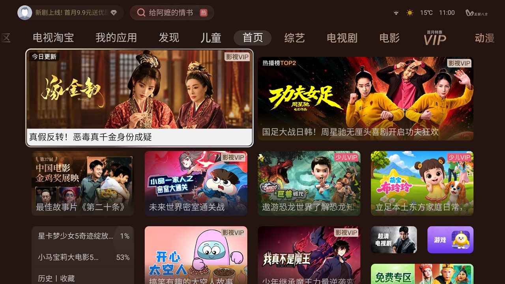
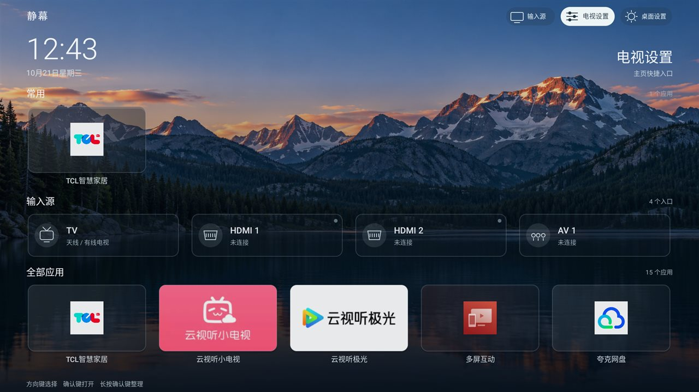
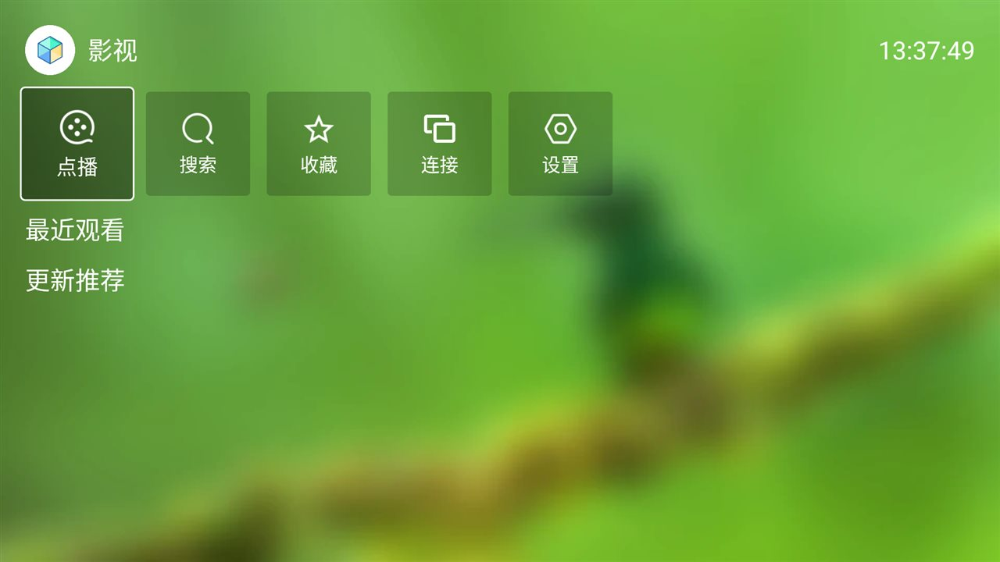

# 雷鸟 / TCL T982（Android 11）清理与换桌面实录

> 设备：FFALCON / TCL `t982_ar31a8`，Android 11（SDK 30），build `RQ3A.210705.001.2024111116`，
> 1080p / 240dpi，2 GB RAM，`armeabi-v7a`，`ro.adb.secure=1`。
> 2026-10-21 单台实机验证。所有改动均可逆，未 root、未刷机、未改系统分区。

**English TL;DR** — On this TCL/FFALCON T982 (Android 11) firmware, `adb install` always fails with
`INSTALL_FAILED_VERIFICATION_FAILURE`: the packageinstaller verifier contains a `LauncherStrategy` that
compares the incoming APK's signer with the TCL launcher certificate and silently drops any new
HOME-capable package (log: `NameNotFoundException` + `The installing app not support tcl ui tab !`).
The verified workaround: temporarily `pm disable-user com.android.packageinstaller`, run
`adb install`, then immediately `pm enable` it again; switch HOME with
`cmd package set-home-activity`. Debloat uses `pm disable-user` only (24 ad/telemetry/bloat packages,
see §3), so everything is reversible. `restore.cmd` reverts the changes, `control.cmd` opens scrcpy
with the software encoder (the Amlogic hardware encoder produces corrupt frames).

## 效果

| 改造前：原厂 CyberUI（推荐流 / 电视淘宝 / VIP 推广） | 改造后：静幕 QuietTV（无推荐流，输入源直达） |
| --- | --- |
|  |  |

## 1. 这台固件的安装限制（实测结论）

| 通道 | 结果 |
| --- | --- |
| `adb install` / `pm install` / `cmd package install` | `INSTALL_FAILED_VERIFICATION_FAILURE`，即使 `verifier_verify_adb_installs=0`、`package_verifier_enable=0` |
| 伪装安装器（`pm install -i com.tcl.guard` 等） | 同样失败 |
| 系统安装器 `com.android.packageinstaller/.PackageInstallerActivity` | **未导出**，外部 `am start` 报 `Permission Denial ... not exported` |
| 电视卫士 `com.tcl.guard` 的"应用安装" | 只扫描 USB 存储，不识别 `/sdcard` |
| 欢视助手 `tv.huan.tvhelper` 口令通道 | 网页上传单文件 ≤ 10 MB；电视端口令为十六进制软键盘（`input text` 无效，需坐标点按）；安装带 `HOME` 声明的 APK 会卡"正在安装"后超时 |

根因（logcat 实测）：`com.android.packageinstaller` 的安装校验器 `StrategyChain` 中有
`LauncherStrategy.isTclLauncher()`：它读取待安装包的签名，与 TCL 桌面（`com.tcl.cyberui`）的证书比对，
未安装的新包直接 `NameNotFoundException` → `allowInstall=false` → 安装被静默丢弃。

```
W verifier: fetch signature info from :com.tcl.cyberui
W System.err: android.content.pm.PackageManager$NameNotFoundException: local.quiettv.launcher
    at ...InstallUtil.getPackageInfo(InstallUtil.java:32)
    at ...strategy.LauncherStrategy.isTclLauncher(LauncherStrategy.java:139)
W verifier: The installing app not support tcl ui tab !
```

即：**普通应用可装，全新第三方桌面（带 HOME）在本固件上任何通道都装不了。**

## 2. 可用的安装通道（桌面类应用）

临时停用安装校验器 → `adb install` → **立即恢复**：

```bash
adb connect <TV_IP>:5555
adb shell pm disable-user --user 0 com.android.packageinstaller
adb install -r QuietTV.apk
adb shell pm enable --user 0 com.android.packageinstaller   # 必须立刻恢复
```

注意事项：

- `com.android.packageinstaller` 不要长时间停用（社区反馈可能影响开机与后续安装）；
- 此方法同样适用于 `pm install` 被 -22 拒绝的其他 TCL 固件，但**不保证所有版本**；
- 安装后如出现"选择主屏幕应用"对话框，选择目标桌面并点「始终」，或改用下方命令。

设置 / 恢复默认桌面（Android 11 可用）：

```bash
adb shell cmd package set-home-activity --user 0 local.quiettv.launcher/.MainActivity
# 恢复原桌面
adb shell cmd package set-home-activity --user 0 com.tcl.cyberui/.MainActivity
```

新装任何带 HOME 的应用会顶掉默认偏好、按 Home 弹 `ResolverActivity`，需重新选择或重跑命令。

## 3. 停用的 24 个包（`pm disable-user`，可逆）

```
# 广告 / 遥测 / 推送 / 静默安装通道
com.tcl.bootadservice                 # 开机全屏广告
com.tcl.bi                            # TCL 数据统计上报
com.tcl.c2dm.client                   # TCL 推送长连接
com.tcl.recognize.service             # 屏幕识别 + 静默安装通道
com.tcl.wholenetsearch                # 全网搜索推广
com.tcl.playskill                     # "使用技巧"推广
com.tcl.appreciate.art                # 推广艺术屏保
com.tcl.useragreement                 # 用户协议弹窗
com.tcl.logkit                        # 日志收集上传
android.autoinstalls.config.tcl.device # 首次开机自动装预装

# 预装推广 / 小应用
com.tcl.tshop                         # TCL 商城
com.tcl.gamecenter                    # 游戏中心
com.tcl.ffeducation                   # 少儿教育
com.tcl.videocall                     # 电视视频通话
com.tcl.weixin                        # 电视版微信
com.tcl.tclmusic                      # TCL 音乐
com.tcl.browser                       # 电视浏览器
com.tcl.common.weather                # 天气小组件
com.audiocn.karaoke.micmanager        # 卡拉OK麦克风管理
com.huawei.himovceie                  # 预装"华为视频"（包名存疑，见 §7）
com.hunantv.market                    # 芒果应用市场

# 用户选择停用
com.tcl.walleve                       # 讯飞语音引擎（停用后遥控语音键失效）
com.tcl.micmanager                    # 麦克风管理
com.tcl.usercenter                    # TCL 账号 / VIP
```

**保留未动**：`com.tcl.cyberui`（原桌面）、`com.tcl.settings`、`com.tcl.tv`、`com.droidlogic.tvinput`
（HDMI/信号源底层）、`com.tcl.autopair` / `com.tcl.tcl_bt_rcu_service`（遥控配对）、
`com.sohu.inputmethod.sogou.tv`（唯一输入法）、`com.tcl.appmarket2`、`com.tcl.guard`、
`com.tcl.systemserver`、`com.tcl.ttvs`、`com.tcl.TFDS.service`、`com.tcl.providers.config`、
`com.tcl.initsetup`、`com.tvos`、投屏（`com.tcl.miracast` / `com.tcl.MultiScreenInteraction_TV`）、
OTA（`com.tcl.versionUpdateApp` / `com.tcl.UpdatePeripheral` / `com.snm.upgrade`）、直播（`com.gitv.dvb.live`）。

## 4. 桌面

| 桌面 | 结果 |
| --- | --- |
| **静幕 QuietTV v0.14.2**（MIT，2.17 MB，`local.quiettv.launcher`） | ✅ 正常，设为默认；**重启验证通过**：开机直达、24 个停用包保持、ADB 自动恢复 |
| FLauncher 0.18.0（Flutter，26.7 MB） | ❌ 2 GB 内存机型卡启动画面 > 60 s，无日志，已卸载 |
| 原桌面 CyberUI | 保留，随时可切回 |

## 5. 电脑端控制（scrcpy）

Amlogic 硬编码器输出的码流有坏帧（`QP 52 out of range` / `no frame`），必须改用软件编码器：

```bash
scrcpy -s <TV_IP>:5555 --max-size 1280 --video-bit-rate 2M --no-audio \
       --video-encoder c2.android.avc.encoder
```

## 6. 回滚与工具

本仓库附带两个脚本（需 `adb` / `scrcpy` 在 PATH，先 `set TV_IP=<电视IP>`）：

- `restore.cmd`：恢复 24 个停用包 + 默认桌面切回 `com.tcl.cyberui` + 可选卸载静幕；
- `control.cmd`：用 scrcpy 从电脑控制电视（强制软件编码器）。

改动前建议自行备份：`pm list packages -e --user 0`、`settings list global/secure/system`、`getprop`
导出到本地即可。若误操作导致电视异常：只要 ADB 还能连上，执行恢复脚本即可；不要先恢复出厂。

## 7. 教训与坑

- **包名标签不要猜**：本次把 `com.huawei.himovceie` 标成"华为视频"建议卸载，事后发现下载站标注
  影视仓 TV 版也用同一包名（蹭 huawei 字样的伪装包），可能误删用户旧应用。停用/卸载前应先用
  `aapt2 dump badging` 或 `dumpsys package` 核对真实 label。
- **不要依赖 `verifier_verify_adb_installs`**：对本固件无效，真正的拦截在安装器 Strategy 链。
- **默认桌面改动后必须重启验证**：部分 TCL 固件开机由系统服务抢回原桌面（本机未发生）。
- **停用包后等 10 秒再重启**：PackageManager 落盘有延迟。
- scrcpy 遇到 `QP out of range` 不是电视坏了，换软件编码器即可。
- 欢视助手口令通道单文件 10 MB 上限；电视端口令是十六进制软键盘，需要坐标点按。

## 8. 附：TVBox 系播放器（可选）

静幕桌面之外，本机还验证安装了 FongMi（蜂蜜影视，`com.fongmi.android.tv` 5.7.8 leanback armeabi-v7a，
GitHub 官方 Release、签名 CN=FongMi）。它是影视仓同家族（CatVod 系）开源版，配置目录同为
`/sdcard/tvbox`，历史网盘参数（阿里云盘 OpenAPI / AList / 夸克 / 弹幕）可继续复用；
接口/仓地址需自行配置。本记录不提供任何影视接口或源。


